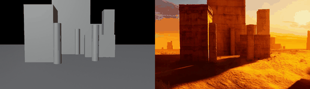

# blender-wan-6gb

**Turn a gray Blender blockout into an AI video that follows your exact camera move, on a 6 GB laptop GPU.**



You block out a scene in Blender with gray boxes and animate the camera. This tool renders an exact depth
pass from Blender and feeds it to **Wan 2.1 VACE 1.3B** in ComfyUI as a control video. Wan then paints the scene
from your prompt while keeping your geometry and camera motion. One command does the whole pipeline:

```
make_video.bat my_scene.blend --prompt "ancient ruins in a desert at sunset" --seconds 5 --fps 24
```

Built and tested on an **RTX 4050 Laptop GPU (6 GB VRAM)** with 32 GB RAM. It should work on any NVIDIA card
with 6 GB or more.

*Türkçe özet aşağıda: [Türkçe](#türkçe)*

## How it works

```
Blender scene ──► depth pass (exact, from geometry) ──► ComfyUI: Wan 2.1 VACE 1.3B ──► RIFE 16→24 fps ──► result.mp4
 (any fps)          sampled at 16 fps                     context windows if > 5 s       (optional)
```

- **Depth comes from Blender, not from an estimator.** You don't need Depth Anything or ControlNet custom nodes.
  The depth is exact and stays stable from frame to frame, so the camera move transfers cleanly.
- **Wan 2.1 runs at 16 fps**, the rate it was trained at. Your Blender scene can be animated at any fps. It is
  sampled at 16 fps with sub-frame precision, so the timing is preserved.
- **24 fps output:** RIFE interpolates ×3 to 48 fps and every second frame is kept, which gives exactly 24 fps.
  This step adds about 35 s.
- **Clips longer than 5 s** use ComfyUI's `WanContextWindowsManual` node: overlapping 81-frame windows over one
  continuous shot.
- **Only core ComfyUI nodes** are used, so you install no custom nodes.

## Requirements

| | Tested with |
|---|---|
| GPU | NVIDIA, 6 GB VRAM (RTX 4050 Laptop) |
| RAM | 32 GB recommended (model weights are offloaded to RAM) |
| [ComfyUI](https://github.com/comfyanonymous/ComfyUI) | 0.46.1 (Comfy Desktop). Needs a recent version with `WanVaceToVideo`, `WanContextWindowsManual`, `FrameInterpolate` |
| [Blender](https://www.blender.org/) | 5.3 (4.2 or newer should work) |

Nothing else is needed: the setup uses the Python that comes with ComfyUI and downloads the models for you.

## Setup (once)

1. Install [ComfyUI](https://www.comfy.org/download) and [Blender](https://www.blender.org/download/).
2. Download this repo: **Code → Download ZIP** and unzip it, or
   `git clone https://github.com/arasarkan/blender-wan-6gb`
3. Start ComfyUI and wait until it has loaded.
4. Double-click **`setup.bat`**.

The setup:
- finds your ComfyUI install, its Python and its `models` folder, and finds Blender;
- downloads the models that are missing (about 11 GB). It asks first, can resume an interrupted download, and
  checks each file against its SHA256. Files you already have are skipped;
- saves the paths it found to `config.json`;
- renders a 1-second test depth pass to make sure Blender works.

<details>
<summary>Models it downloads (official Comfy-Org repos, <code>.safetensors</code> only)</summary>

| File | Folder | Size | Source |
|---|---|---|---|
| `wan2.1_vace_1.3B_fp16.safetensors` | `diffusion_models/` | 4.3 GB | [Comfy-Org/Wan_2.1_ComfyUI_repackaged](https://huggingface.co/Comfy-Org/Wan_2.1_ComfyUI_repackaged/tree/main/split_files/diffusion_models) |
| `umt5_xxl_fp8_e4m3fn_scaled.safetensors` | `text_encoders/` | 6.7 GB | [Comfy-Org/Wan_2.1_ComfyUI_repackaged](https://huggingface.co/Comfy-Org/Wan_2.1_ComfyUI_repackaged/tree/main/split_files/text_encoders) |
| `wan_2.1_vae.safetensors` | `vae/` | 254 MB | [Comfy-Org/Wan_2.1_ComfyUI_repackaged](https://huggingface.co/Comfy-Org/Wan_2.1_ComfyUI_repackaged/tree/main/split_files/vae) |
| `rife_v4.26.safetensors` | `frame_interpolation/` | 23 MB | [Comfy-Org/Frame-Interpolation](https://huggingface.co/Comfy-Org/Frame-Interpolation/tree/main/frame_interpolation) |

The 14B Wan models do not fit in 6 GB, which is why the 1.3B model is used.
</details>

<details>
<summary>Linux / macOS, or if setup.bat can't find ComfyUI</summary>

Run the setup with ComfyUI's own Python, for example:

```
/path/to/ComfyUI/.venv/bin/python setup.py --models-dir /path/to/ComfyUI/models
```

Any Python 3.10+ with `pip install -r requirements.txt` also works. Options: `--server URL`, `--blender PATH`,
`--yes`.
</details>

## Make a video

**Drag your `.blend` file onto `make_video.bat`.** It asks what the video should look like, how long it should
be and the fps, then does the rest. Double-click `make_video.bat` without a file to try the built-in test scene.
ComfyUI has to be running.

From a terminal you can pass everything directly:

```
make_video.bat my_scene.blend --prompt "ancient ruins in a desert at sunset" --seconds 5 --fps 24 --name shot01
```

Check only the depth pass, which takes seconds and doesn't use ComfyUI:

```
make_video.bat my_scene.blend --seconds 5 --depth-only --name shot01
```

On Linux/macOS use `python make_video.py ...` with the Python from `config.json`.

Everything is written to `outputs/<name>/`:

| File | What |
|---|---|
| `result.mp4` | the final video |
| `compare.mp4` | Blender gray preview and result side by side |
| `depth.mp4`, `preview_gray.mp4` | what was sent to Wan / what your blockout looks like |
| `result_16fps.webm` | raw Wan output before interpolation |
| `workflow_api.json`, `settings.json` | the exact ComfyUI workflow and settings, so you can reproduce a run |

### Options

| Option | Default | |
|---|---|---|
| `scene.blend` / `--blend` | built-in test scene | `.blend` with an animated camera |
| `--prompt` / `--negative` | asked if missing | what the scene should look like |
| `--seconds` | 5 | clip length. Anything over 5 s uses context windows |
| `--fps` | 24 | `16` (raw Wan) or `24` (RIFE interpolation) |
| `--width` / `--height` | 832 / 480 | multiples of 16. 832×480 is the sweet spot for 6 GB |
| `--seed`, `--steps`, `--cfg`, `--shift` | 42, 20, 6, 8 | sampler settings |
| `--strength` | 1.0 | how strictly to follow the depth |
| `--camera` | scene camera | camera object to render from |
| `--start` | scene start frame | scene frame to start from |
| `--near` / `--far` | auto | depth range in scene units, mapped to white/black |
| `--depth-curve` | `linear` | `inverse` (disparity, like Depth Anything) gives far more contrast up close. Use it for interiors, colonnades and close-ups |
| `--reuse-depth` | | skip the Blender render if `outputs/<name>` already has it |
| `--server` | from setup | ComfyUI address |

Press Ctrl+C while it's generating to cancel the ComfyUI job.

## Performance (RTX 4050 Laptop, 6 GB, 832×480, 20 steps)

| Clip | Wan frames | Time | Peak VRAM |
|---|---|---|---|
| 2 s | 33 | ~4 min | ~3.7 GB |
| 5 s | 81 | ~15 min (14.6 min measured) | 4.7 GB |
| 5 s → 24 fps | 81 → 121 | +35 s | – |
| 10 s | 161 (3 windows) | ~45 min (estimated) | ~5.2 GB |

Each context window costs about as much as one 5-second clip. Iterate on prompts with short clips or lower
resolution, then render the final version.

## Scene tips

- **Animate the camera** (keyframes, a path or a Track To constraint all work). Only the camera's view
  matters; materials and lights are ignored.
- **Silhouettes matter more than detail.** Boxes become buildings or rocks, cylinders become pillars or trees,
  the ground plane becomes the ground, and empty background becomes sky.
- **Moderate camera speed** works best. Very fast moves can smear.
- **Depth range:** the auto range covers your objects. If the depth looks flat, check `depth.mp4` with
  `--depth-only` and set `--near`/`--far` in scene units.
- **Interiors and close-ups:** with linear depth, everything a few meters from the camera turns almost white.
  Wan then invents stripes and noise. Use `--depth-curve inverse` and set `--near` to the distance of the
  closest object (for example `--near 3.5 --far 80`).
- **Give the floor something to move.** When the camera moves forward over an empty flat floor, the floor's
  depth image is identical in every frame. Wan then paints the floor as if it were stuck to the screen while
  the walls slide past. Scatter a few objects on the ground (rocks, snow piles, bollards, curbs, paving
  steps) and the ground will move with the camera.
- **Keep shots ≤ 5 s** when you can and cut between them, like real editing. Longer continuous shots work but
  cost more time and can drift slightly in color.
- Round shapes sometimes come out square, because depth alone doesn't say "round". Say it in the prompt
  ("round columns").

## Troubleshooting

- **`setup.bat` says ComfyUI is not running**: start ComfyUI and wait until its window has fully loaded.
  If you changed its port, run `setup.py --server http://127.0.0.1:PORT` with ComfyUI's Python.
- **`model ... not found` / `missing core nodes`**: run `setup.bat` again, or update ComfyUI.
- **A download stopped halfway**: run `setup.bat` again and it continues where it stopped.
- **Out of memory**: close other GPU apps such as browsers and games, lower `--width/--height`, or use shorter
  clips.
- **ComfyUI is slow to start the first time**: the first model load reads about 11 GB from disk. Later runs
  are faster.

## License

MIT. See [LICENSE](LICENSE). The models have their own licenses (Wan 2.1: Apache 2.0).

---

## Türkçe

Blender'da gri kutularla bir sahne kurup kamerayı anime edersin. Bu araç Blender'dan derinlik videosu
render eder ve ComfyUI'daki **Wan 2.1 VACE 1.3B** modeline verir. Model senin geometrine ve kamera hareketine
sadık kalarak, prompt'a göre bir video üretir. **6 GB VRAM'li RTX 4050 laptopta** test edildi.

```
make_video.bat sahne.blend --prompt "gün batımında çölde antik harabeler" --seconds 5 --fps 24
```

- **Kurulum:** ComfyUI ve Blender'ı kur. ComfyUI açıkken **`setup.bat`**'a çift tıkla. Modelleri (~11 GB)
  kendisi indirir ve her şeyi ayarlar.
- **Video:** `.blend` dosyanı **`make_video.bat`**'ın üzerine sürükle. Prompt'u, süreyi ve fps'i sorar.
- 5 saniyelik bir video 832×480 çözünürlükte yaklaşık 15 dakika sürer. 24fps'e çevirmek 35 saniye ekler.
- Sonuçlar `outputs/<isim>/` klasörüne yazılır. `compare.mp4` blockout ile sonucu yan yana gösterir.
